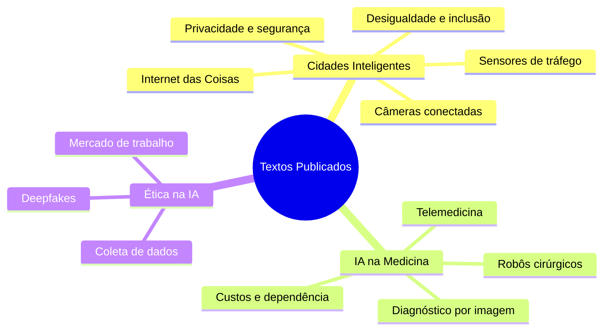
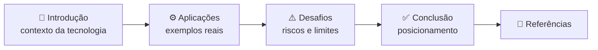

# Textos Publicados

<p align="center">
  
  
  
</p>
<p align="center">
  
  
  
</p>

<p align="center">
  Textos publicados no blog <b>Crescendo Juntos</b> da <b>Faculdade Engenheiro Salvador Arena</b> — reflexões sobre
  Internet das Coisas, Inteligência Artificial na saúde e ética no uso da tecnologia.
</p>

<p align="center">
  <a href="#-vitrine">Vitrine</a> •
  <a href="#-mapa-dos-temas">Mapa dos temas</a> •
  <a href="#-você-sabia">Você sabia?</a> •
  <a href="#-estrutura-do-repositório">Estrutura</a>
</p>

---

## 📚 Vitrine

<table>
  <tr>
    <th width="33%">🏙️ Cidades Inteligentes</th>
    <th width="33%">🩺 IA na Medicina Moderna</th>
    <th width="33%">⚖️ Ética na IA</th>
  </tr>
  <tr>
    <td valign="top">
      <b>Internet das Coisas (IoT) aplicada às Cidades Inteligentes</b><br/><br/>
      Mostra como sensores de monitoramento de tráfego e câmeras de segurança conectadas a uma rede IoT podem
      melhorar a mobilidade urbana e a segurança — e por que privacidade, segurança e desigualdade precisam ser
      enfrentadas para que as cidades inteligentes sejam inclusivas.
    </td>
    <td valign="top">
      <b>Inteligência Artificial na Medicina Moderna</b><br/><br/>
      Analisa vantagens e desvantagens da IA na medicina — diagnóstico a partir de dados e imagens, telemedicina e
      robôs cirúrgicos — e conclui que ela é um grande auxílio, mas não pode criar dependência da máquina pelos médicos.
    </td>
    <td valign="top">
      <b>Ética na Inteligência Artificial</b><br/><br/>
      Discute os problemas e responsabilidades éticas da IA no cotidiano: deepfakes e manipulação de informações,
      privacidade na coleta massiva de dados e o impacto da automação no mercado de trabalho.
    </td>
  </tr>
  <tr>
    <td align="center">
      <a href="textos/Cidades%20Inteligentes.md"></a>
      <a href="https://cefsa.org.br/crescendojuntos/como-a-internet-das-coisas-esta-criando-cidades-inteligentes/"></a>
    </td>
    <td align="center">
      <a href="textos/Intelig%C3%AAncia%20Artificial%20na%20Medicina%20Moderna.md"></a>
      <a href="https://cefsa.org.br/crescendojuntos/a-introducao-da-inteligencia-artifical-na-medicina/"></a>
    </td>
    <td align="center">
      <a href="textos/%C3%89tica%20na%20Intelig%C3%AAncia%20Artificial.md"></a>
    </td>
  </tr>
</table>

| Texto | Seções | Referências | Leitura |
|---|---|:---:|:---:|
| [Cidades Inteligentes](textos/Cidades%20Inteligentes.md) | Introdução · Aplicações da IoT · Desvantagens e Desafios · Conclusão | 4 | ~4 min |
| [IA na Medicina Moderna](textos/Intelig%C3%AAncia%20Artificial%20na%20Medicina%20Moderna.md) | Introdução · Telemedicina · Desvantagens e Desafios · Exemplos de Aplicação · Conclusão | 7 | ~4 min |
| [Ética na IA](textos/%C3%89tica%20na%20Intelig%C3%AAncia%20Artificial.md) | Introdução · Deepfakes · Privacidade e Coleta de Dados · Mercado de Trabalho · Conclusão | — | ~3 min |

## 🧠 Mapa dos temas



Os três textos seguem o mesmo raciocínio: apresentar a tecnologia, mostrar onde ela já é aplicada, pesar os
desafios e concluir com um posicionamento.



## 💡 Você sabia?

<details>
<summary><b>🏙️ Uma central de monitoramento com mais de 30 agências</b></summary>
<br/>

A cidade do Rio de Janeiro testou uma central de monitoramento que integra mais de 30 agências municipais e
estaduais, permitindo a supervisão da cidade durante 24 horas com sensores e câmeras para gerenciar áreas críticas
como tráfego e segurança. — *[Cidades Inteligentes](textos/Cidades%20Inteligentes.md)*

</details>

<details>
<summary><b>🤖 Mais de 20 mil cirurgias robóticas em uma década</b></summary>
<br/>

Segundo o jornal *Estado de Minas*, o Brasil é o país que mais faz cirurgias robóticas na América Latina, com mais
de 20 mil na última década. — *[IA na Medicina Moderna](textos/Intelig%C3%AAncia%20Artificial%20na%20Medicina%20Moderna.md)*

</details>

<details>
<summary><b>🧬 Redes neurais × dermatologistas: 72% contra 66%</b></summary>
<br/>

Sebastian Thrun, da Universidade de Stanford, projetou um sistema de redes neurais que diagnosticou lesões benignas,
malignas e crescimentos não cancerígenos com 72% de acerto, ultrapassando dermatologistas qualificados, que obtiveram
66%. — *[IA na Medicina Moderna](textos/Intelig%C3%AAncia%20Artificial%20na%20Medicina%20Moderna.md)*

</details>

<details>
<summary><b>🎭 O desafio de distinguir o real do gerado por IA</b></summary>
<br/>

Grande parte da população ainda não tem conhecimento e discernimento suficiente para diferenciar o que é real do que
é uma imagem gerada por IA, o que cria grande responsabilidade para quem produz esse tipo de material.
— *[Ética na IA](textos/%C3%89tica%20na%20Intelig%C3%AAncia%20Artificial.md)*

</details>

## 📁 Estrutura do Repositório

```text
Textos-Publicados/
├── textos/                                          # textos em Markdown, um arquivo por publicação
│   ├── Cidades Inteligentes.md                      # IoT aplicada às cidades inteligentes
│   ├── Inteligência Artificial na Medicina Moderna.md
│   └── Ética na Inteligência Artificial.md
└── README.md
```

> [!NOTE]
> Os textos foram originalmente publicados no blog da faculdade. Cada arquivo traz, no início, o link para a
> publicação original e as referências bibliográficas consultadas, quando disponíveis.

---

<p align="center">
  <b>Produção textual sobre tecnologia e sociedade, aproximando Inteligência Artificial, Internet das Coisas e ética
  do leitor do blog Crescendo Juntos.</b>
</p>
